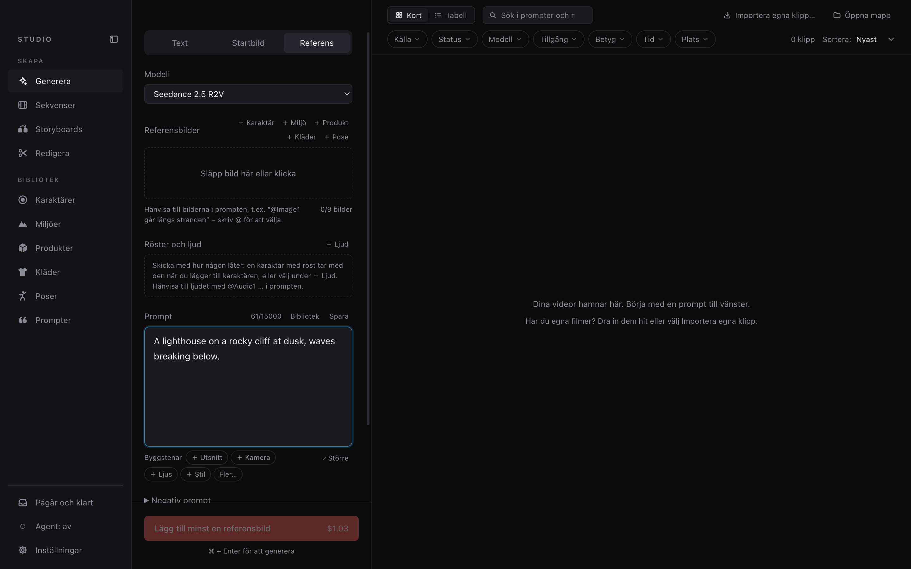
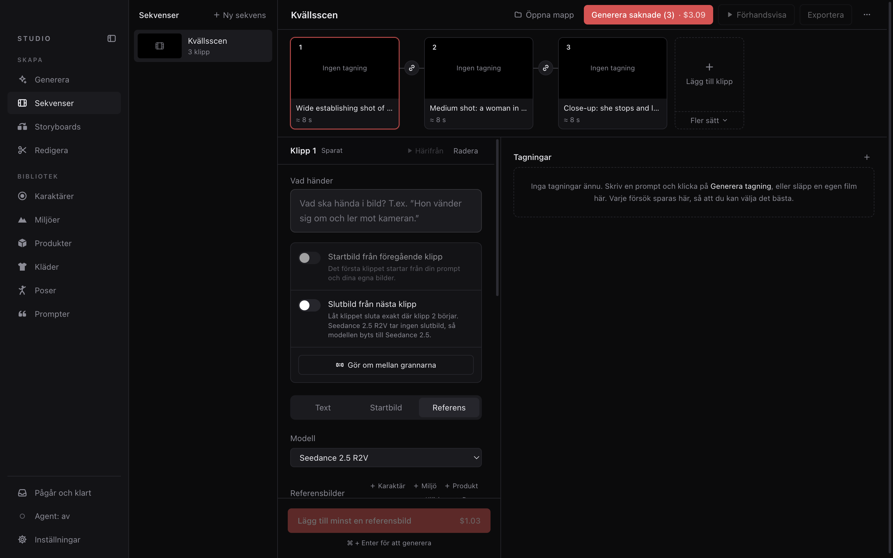
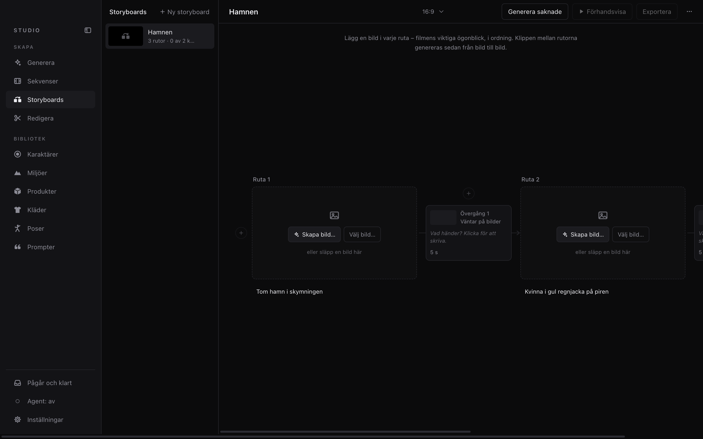

# Studio

Make films with [Venice.ai](https://venice.ai)'s video models, on your Mac.



## Install

```bash
curl -fsSL https://raw.githubusercontent.com/jensbjork/studio/main/install.sh | bash
```

Needs a Mac with Apple Silicon (macOS 13+) and a [Venice API key](https://venice.ai/settings/api). The script
installs ffmpeg with Homebrew if it's missing, puts Studio in Applications and opens it.

Rather download it yourself? Get `Studio-mac-arm64.dmg` from
[Releases](https://github.com/jensbjork/studio/releases/latest). The app isn't notarized, so the first time macOS
stops it: open **System Settings → Privacy & Security** and click **Open Anyway**.

## Get started

1. Choose a folder for your library.
2. **Inställningar** → paste your Venice API key.
3. Write a prompt and press **Generera**.

The interface is in Swedish. You pay Venice per generation; the price is shown before you generate.

## How it works

- **Generera** – a clip from text, a start image, or reference photos and voices you point at in the prompt
  (`@Image1`, `@Audio1`).
- **Bibliotek** – characters, environments, products, outfits and poses: photos, a description and a voice.
  Their descriptions are added to the prompt for you.
- **Sekvenser** – clips that continue from each other's last frame, exported as one film.
- **Storyboards** – one picture per moment; the clips between them are generated.
- **Redigera** – cut, clean up the sound, replace a voice, add music, redo a stretch with AI. Every change is a
  new version; the original is never touched.
- **Agents** – connect your own AI agent over [MCP](https://modelcontextprotocol.io). It can do what you can;
  anything that costs money or deletes something waits for your OK.

Everything is stored as plain files in the folder you chose.

| Sekvenser | Storyboards |
| --- | --- |
|  |  |
| **Redigera** | **Writing help** – type `/` for ready-made phrases |
|  |  |

## More

- [Guide](docs/GUIDE.md) – every feature in detail
- [Agents](docs/AGENTS.md) – connecting your own agent
- [Development](docs/DEVELOPMENT.md) – `npm install && npm run dev`
- [Architecture](docs/ARCHITECTURE.md) · [Contributing](CONTRIBUTING.md) · [Security](SECURITY.md) ·
  [Changelog](CHANGELOG.md)

## License

[MIT](LICENSE)
