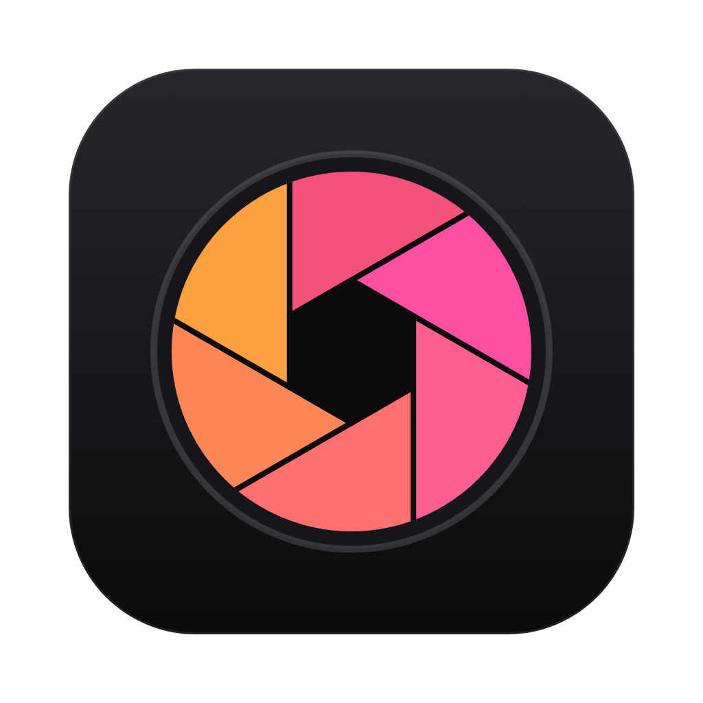
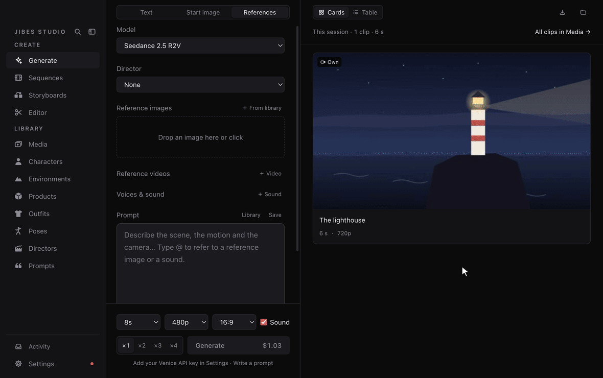
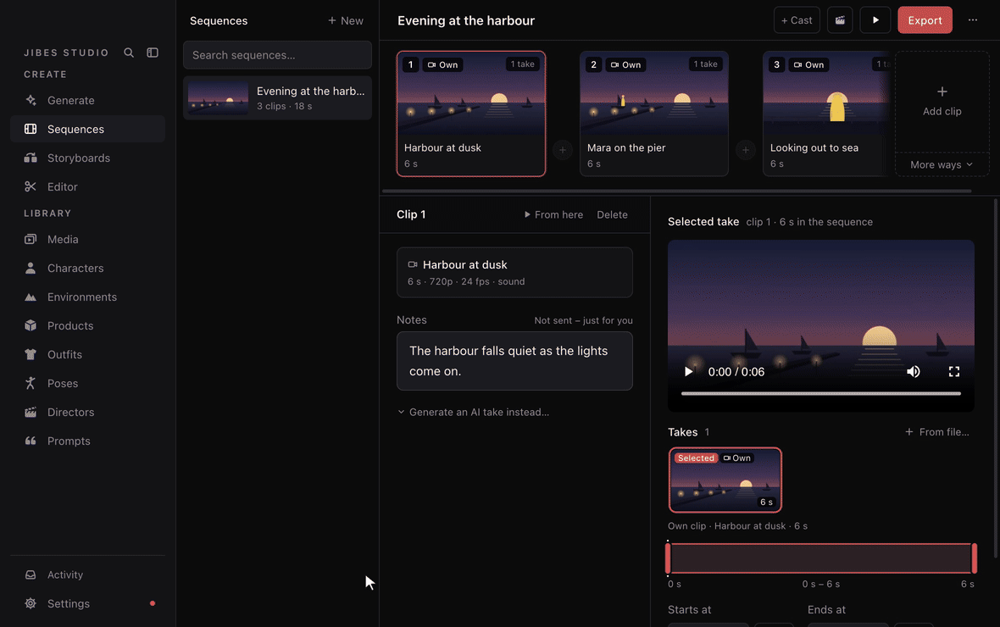
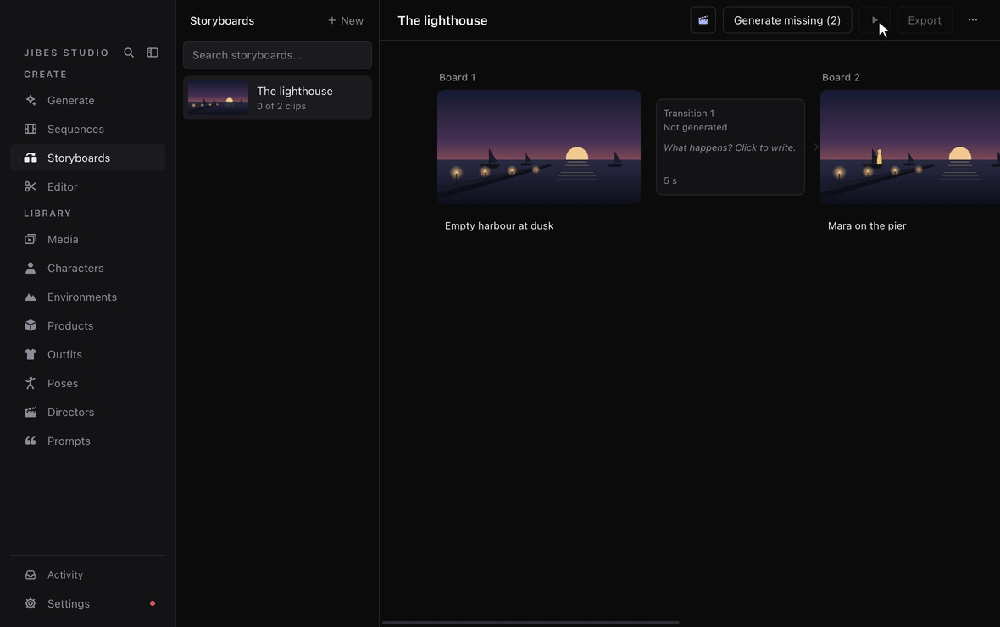
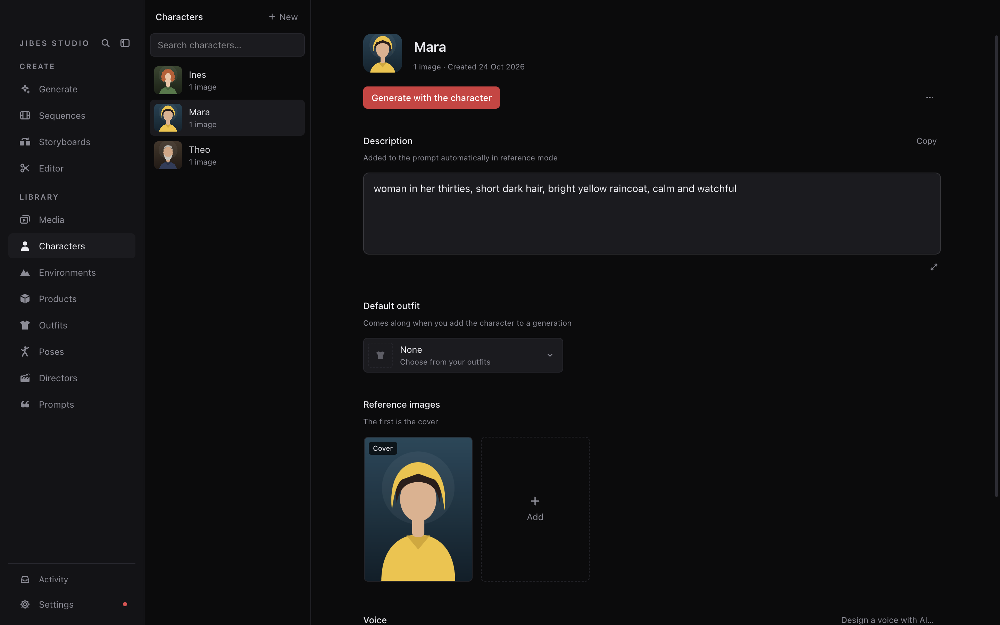
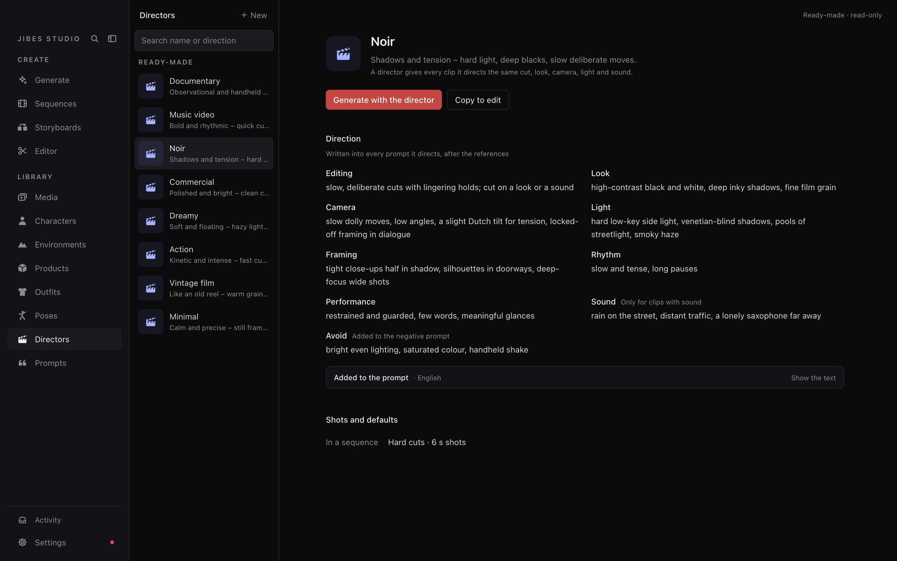
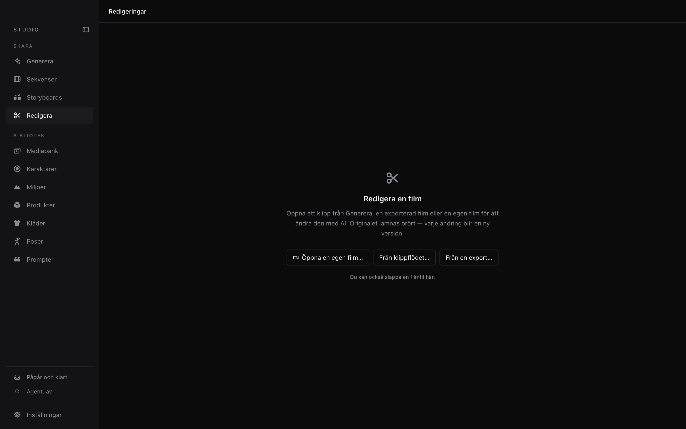
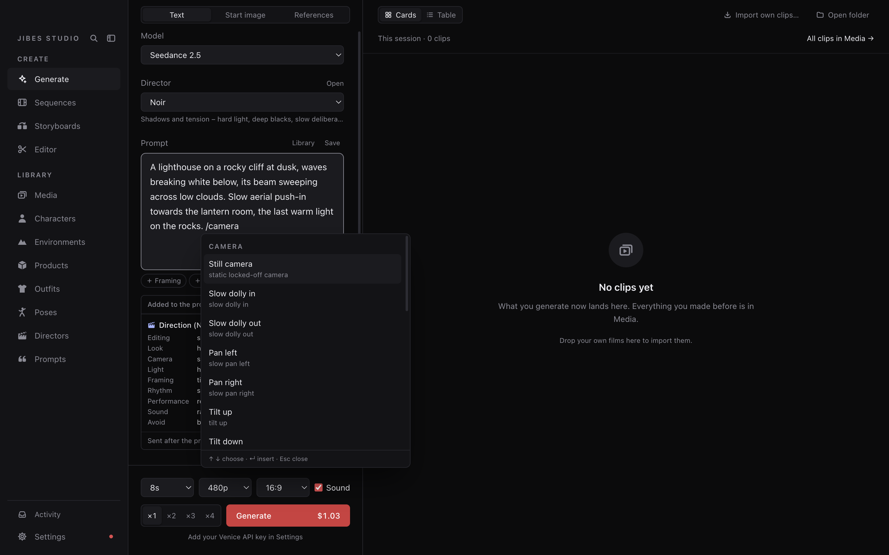

<p align="center">
  
</p>

<h1 align="center">JIBES Studio</h1>

<p align="center">
  <strong>Make films with the video models of <a href="https://venice.ai">Venice.ai</a> or
  <a href="https://fal.ai">fal.ai</a></strong> – from a single clip to a whole story,<br>with your own characters,
  places and style. On your Mac or Windows PC.
</p>

<p align="center">
  <a href="https://github.com/jensbjork/jibes-studio/releases/latest"></a>
  
  
  <a href="LICENSE"></a>
</p>

<p align="center">
  <a href="#install"><strong>Install</strong></a> ·
  <a href="#your-first-film"><strong>Your first film</strong></a> ·
  <a href="docs/GUIDE.md"><strong>Guide</strong></a>
</p>



## What it does

**Cast once, use everywhere.** Characters, places, products, outfits and poses live in your library – photos, a
description and a voice. Add them to a generation and point at them in the prompt with `@`; their descriptions go
along for you, so Mara looks like Mara in every clip.

**From a clip to a film.** A sequence is your film, clip by clip. A clip can start on the last frame of the one
before, keeps every take you make and is trimmed where you want the cut. Watch the whole film in **Preview**, then
export it as one video.



**Plan it as a storyboard.** One picture per moment, a note under each. **Suggest** writes a first prompt for what
happens between two pictures, and **Generate missing** makes every clip that joins them.



**Give it a director.** A director is a way of making a film – editing, look, camera, light, framing, rhythm,
performance and sound – that every prompt it directs carries. Start from eight ready-made ones (Noir, Documentary,
Music video …) or write your own.

**Finish it in the Editor.** Cut, fade, clean up the sound, replace a voice, add music or redo a stretch with AI – and
with fal.ai, make the mouths follow new lines (lip sync). Every change is a new version; the original is never touched.

**Bring your own agent.** Connect Claude or any other agent that speaks [MCP](https://modelcontextprotocol.io). It can
do nearly everything you can – build characters, write prompts, plan sequences – but anything that costs money or
deletes something waits for your OK.

| **Library** – photos, a description and a voice | **Directors** – eight to start from, or your own |
| --- | --- |
|  |  |
| **Editor** – every change a new version | **Writing help** – type `/` for ready-made phrases |
|  |  |

## Install

**Mac** (Apple Silicon, macOS 13 or later) – paste this into Terminal:

```bash
curl -fsSL https://raw.githubusercontent.com/jensbjork/jibes-studio/main/install.sh | bash
```

It installs ffmpeg with Homebrew if it's missing, puts JIBES Studio in Applications and opens it.

<details>
<summary>Rather download it yourself?</summary>

Get `JIBES-Studio-mac-arm64.dmg` from [Releases](https://github.com/jensbjork/jibes-studio/releases/latest). The app
isn't notarized, so the first time macOS stops it: open **System Settings → Privacy & Security** and click
**Open Anyway**.

</details>

**Windows** (10 or 11, 64-bit) – download `JIBES-Studio-win-x64-setup.exe` from
[Releases](https://github.com/jensbjork/jibes-studio/releases/latest) and run it, or unzip `JIBES-Studio-win-x64.zip`
anywhere. ffmpeg comes with it. The app isn't signed, so SmartScreen warns the first time: click
**More info → Run anyway**.

JIBES Studio tells you when a new version is out and updates itself when you choose **Update now**.

## Your first film

JIBES Studio is free. You need an account with some credit at [Venice](https://venice.ai) or [fal.ai](https://fal.ai):
you pay the service per generation, and the price is on the button before you press it.

1. **Choose a library folder.** The first time it opens, Studio asks where to keep your work (suggested: *JIBES
   Studio* in your Movies folder – Videos on Windows). Everything is stored there as plain files.
2. **Add your API key.** Create one at [venice.ai/settings/api](https://venice.ai/settings/api) or
   [fal.ai/dashboard/keys](https://fal.ai/dashboard/keys), then open **Settings** (⌘, on a Mac, Ctrl+, on Windows) →
   **Service**, choose the service and paste it. Set a daily or monthly budget under
   **Spending** if you like.
3. **Make a clip.** **Generate** → **Text**: describe the scene, choose the length and resolution, press
   **Generate**. The clip appears beside the form when it's done.
4. **Cast someone.** **Characters** → **New**: a name, a photo or two and a short description. Back in Generate,
   choose **References** → **＋ From library**, pick the character and type `@` in the prompt to point at it.
5. **Make it a film.** **Sequences** → **New**. Write the first clip and generate a take, then add the next clip –
   it can start on the last frame of the one before. **Preview** plays it all; **Export** makes one video.

Stuck? ⌘K (Ctrl+K) finds anything in the app, and the [guide](docs/GUIDE.md) explains every view.

## Good to know

- **Your files stay yours.** The library is a folder of ordinary files on your computer, and your API keys are stored
  encrypted by the system. Pictures, clips and prompts leave your computer only when you send them to Venice or
  fal.ai – or to an agent you connect yourself.
- **Two services.** Generate with Venice or fal.ai and switch whenever you like in Settings → Service; each keeps its
  key, and what you made stays. The [guide](docs/GUIDE.md#services-venice-and-falai) says what differs.
- **No surprise costs.** Every paid action shows its price first, the optional budget asks before going past it, and
  an agent can never spend or delete on its own.
- **Keyboard first.** The same keys work in every view – see [Keyboard shortcuts](docs/GUIDE.md#keyboard-shortcuts).

## More

- [Guide](docs/GUIDE.md) – every feature in detail
- [Agents](docs/AGENTS.md) – connecting your own agent
- [Development](docs/DEVELOPMENT.md) – `npm install && npm run dev`
- [Architecture](docs/ARCHITECTURE.md) · [Contributing](CONTRIBUTING.md) · [Security](SECURITY.md) ·
  [Changelog](CHANGELOG.md)

## License

[MIT](LICENSE). The Windows build includes FFmpeg, under the GPL: see [third-party notices](THIRD_PARTY_NOTICES.md).
